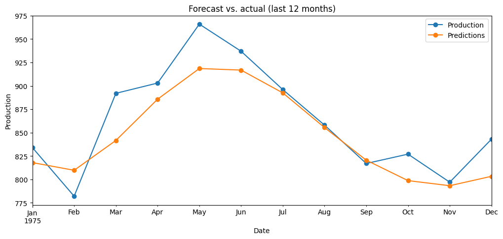
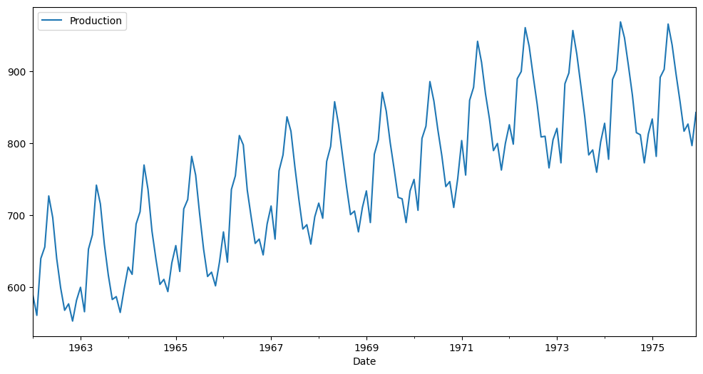
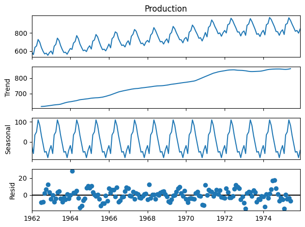
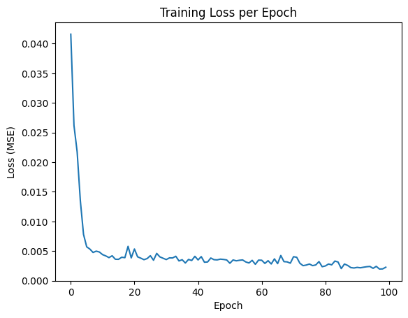

# Monthly Milk Production Forecasting with LSTM


Univariate time-series forecasting of monthly milk production (1962–1975) using a Long Short-Term Memory (LSTM) neural network built with TensorFlow/Keras. The model learns from the previous 12 months and forecasts the final 12 months of the dataset recursively.



## Results

| Metric | Value |
| --- | --- |
| Test set | Last 12 months (1975) |
| Forecast type | Recursive (each prediction is fed back as input) |
| **R² score** | **0.746** |

The LSTM reproduces the seasonal shape of the held-out year but under-predicts the spring/summer peak and smooths out the sharp early-year dip. Because the forecast is recursive, errors can compound across the 12-month horizon.

## Dataset

[`data/monthly_milk_production.csv`](data/monthly_milk_production.csv) contains 168 monthly observations (Jan 1962 – Dec 1975) with two columns: `Date` (`YYYY-MM`) and `Production`. The series has a clear upward trend and strong yearly seasonality.

| Monthly series | Seasonal decomposition |
| --- | --- |
|  |  |

## Methodology

1. **Exploration** – plot the series and run a seasonal decomposition (`statsmodels`) to confirm trend and 12-month seasonality.
2. **Chronological split** – first 156 months for training, last 12 months for testing. No shuffling, to avoid leaking future information into training.
3. **Scaling** – `MinMaxScaler` fit on the training data only, then applied to the test data.
4. **Sequence generation** – `TimeseriesGenerator` with a 12-month input window predicting the next month.
5. **Model** – `LSTM(100, activation='tanh')` → `Dense(1)`, trained with Adam and MSE loss for 100 epochs.
6. **Forecasting** – recursive 12-step forecast: each prediction is appended to the input window while the oldest value is dropped.
7. **Evaluation** – predictions are inverse-scaled and scored against the held-out year with R².



## Project structure

```
milk-production-lstm-forecasting/
├── data/
│   └── monthly_milk_production.csv
├── notebooks/
│   └── lstm_milk_production_forecasting.ipynb
├── reports/
│   └── figures/
├── requirements.txt
├── LICENSE
└── README.md
```

## Getting started

```bash
git clone https://github.com/<your-username>/milk-production-lstm-forecasting.git
cd milk-production-lstm-forecasting

python -m venv .venv
source .venv/bin/activate        # Windows: .venv\Scripts\activate
pip install -r requirements.txt

cd notebooks
jupyter lab
```

Open `lstm_milk_production_forecasting.ipynb` and run all cells. Run it from the `notebooks/` folder so the relative path to `../data/` resolves.

The notebook was verified to run end to end with TensorFlow 2.21 (Keras 3) on Python 3.12.

## Reproducibility note

Only Python's built-in `random` module is seeded, so retraining gives slightly different numbers each run. The R² reported above comes from the original run (0.7459); a fresh re-run gave 0.745. Seeding NumPy and TensorFlow (`np.random.seed`, `tf.random.set_seed`) would make runs repeatable.

## Limitations and next steps

- Only one train/test split and one 12-month test window, so the score is a single noisy estimate.
- No baseline comparison yet (e.g. seasonal-naive, SARIMA/ETS) to show how much the LSTM adds over simpler models.
- No validation set or early stopping; overfitting cannot be ruled out from the training-loss curve alone.
- Only R² is reported; adding RMSE/MAE/MAPE would make errors easier to interpret in production units.
- Possible extensions: hyperparameter tuning (window size, units, layers), direct multi-step forecasting, and repeated runs over several seeds.

## Tech stack

Python · TensorFlow/Keras · pandas · NumPy · scikit-learn · statsmodels · Matplotlib · Jupyter

## Author

**Yogeshwaran S** — Coimbatore, India

## License

Released under the [MIT License](LICENSE).
